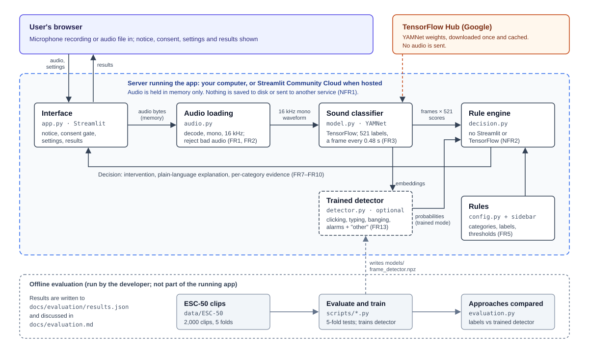
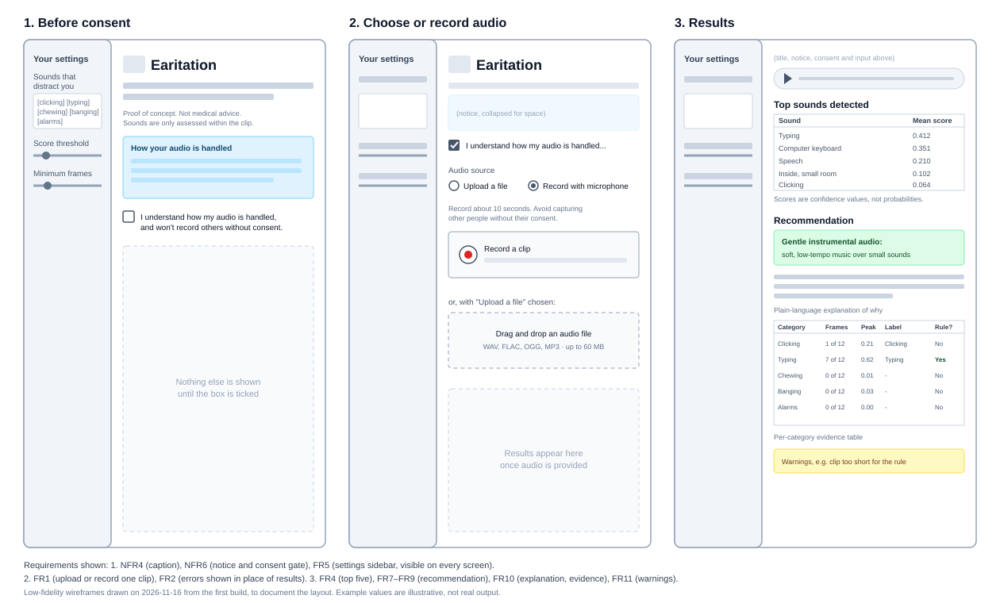

# System design

Design artefacts for report section 4. Requirements are in
[`../requirements.md`](../requirements.md), decisions in
[`../decisions.md`](../decisions.md), and the requirement-to-test table in
[`../traceability.md`](../traceability.md).

## Architecture

The app is a pipeline of four modules, each with one job, plus a configuration
module. Data flows left to right and the decision comes back to the interface.

| Module | Responsibility | Depends on | Requirements |
| --- | --- | --- | --- |
| `app.py` | Streamlit interface: notice, consent gate, settings, input, results | Streamlit and the modules below | FR1, FR4, FR5, NFR4, NFR6 |
| `audio.py` | Decode an upload or recording, convert to 16 kHz mono, reject bad input | soundfile, SciPy | FR1, FR2 |
| `model.py` | Run YAMNet: per-frame scores for 521 labels, and embeddings | TensorFlow, TensorFlow Hub | FR3, NFR3 |
| `predictions.py` | Hold the frames × labels score table; rank the top labels | NumPy | FR4 |
| `decision.py` | Apply the rules; produce intervention, explanation, evidence | NumPy only | FR6–FR11, NFR2, NFR5 |
| `config.py` | Default categories, labels, interventions and thresholds | `decision.py` | FR5 |
| `evaluation.py` | Offline ESC-50 comparison (not used by the app) | scikit-learn | ML investigation |

### Design principles

- **The rule engine knows nothing about the interface or the model** (NFR2).
  `decision.py` takes a table of scores and a configuration and returns a
  `Decision`. It can be unit tested with hand-made score tables, which is how
  all 20 of its tests work, and it would work unchanged with a different
  classifier.
- **TensorFlow is loaded only when needed.** `model.py` imports it inside the
  class, so tests and modules that do not need the model start quickly.
- **Immutable data between stages.** Configuration, predictions and decisions
  are frozen dataclasses, so one stage cannot change another's data.
- **Invalid configuration fails early.** `EngineConfig` checks its own values
  when created: a threshold must be above 0 and at most 1, the minimum frame
  count at least 1, and every category's intervention must exist.
- **Audio never touches disk** (NFR1, decision D2). Uploads and recordings are
  read from memory and discarded when the page reruns.

### Data passed between stages

| From → to | Data |
| --- | --- |
| Browser → `app.py` | Audio bytes from an upload or the microphone; sidebar settings |
| `app.py` → `audio.py` | The bytes, wrapped as an in-memory file |
| `audio.py` → `model.py` | Float32 waveform, 16 kHz mono, values in [-1, 1], at most 5 minutes |
| `model.py` → `decision.py` | `FramePredictions`: label names and a frames × 521 score table (one frame per 0.48 s) |
| `config.py` + sidebar → `decision.py` | `EngineConfig`: categories, labels, threshold, minimum frames, interventions |
| `decision.py` → `app.py` | `Decision`: intervention or none, explanation, per-category evidence, warnings |

### The decision rule

For each category, in each frame, the category's score is its best label's
score. A frame counts if that score is at least the threshold (default 0.2).
The category triggers if at least the minimum number of frames count
(default 4, about 2 seconds). Then:

| Categories triggered | Recommendation |
| --- | --- |
| None | No intervention (FR9) |
| One | That category's intervention (FR7) |
| Two or more | General focus audio (FR8) |

Labels that YAMNet does not have are reported as warnings and ignored (FR11).
The defaults are provisional; see the evaluation's limitations.

## Wireframes

The interface is a single page that reveals itself in three states:

1. **Before consent.** Title, a caption saying this is not medical advice and
   that sounds are assessed only within the clip (NFR4, NFR5), the audio
   handling notice, and the consent checkbox (NFR6). Nothing else appears
   until the box is ticked.
2. **Choose or record audio.** Upload a file or record one clip with the
   microphone (FR1). Problems with the audio are shown here as an error in
   place of results (FR2).
3. **Results.** The recording can be played back, then come the top five
   sounds (FR4), the recommendation (FR7–FR9), the explanation and a
   per-category evidence table (FR10), and any warnings (FR11).

The settings sidebar is visible in every state, and changing a setting re-runs
the analysis immediately (FR5).

These wireframes were drawn on 2026-11-16, after the first build, to document
the layout; the requirements they implement were written first (commit
`4be7598`). Example values in them are illustrative.

## Deployment

| Mode | Where audio is processed | How to run |
| --- | --- | --- |
| Local | The user's own computer | `streamlit run app.py --server.address localhost` |
| Hosted | Streamlit Community Cloud | Deploy `app.py` from `main`, Python 3.11, invited viewers only |

In both modes the only outbound request the app makes is the one-time YAMNet
download from TensorFlow Hub.
